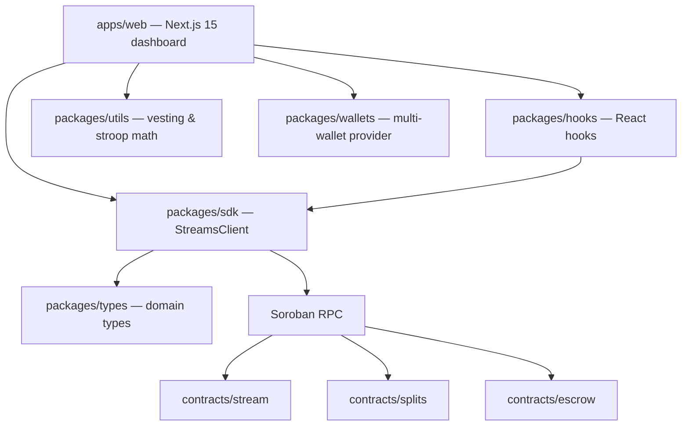

# Architecture

How the Stellar Streams protocol is put together.

---

## Overview

Stellar Streams is a pnpm + Turborepo monorepo containing Soroban smart contracts, a typed
TypeScript SDK, shared utilities, and a Next.js dashboard.



---

## On-chain layer (`contracts/`)

Rust workspaces built with [soroban-sdk](https://crates.io/crates/soroban-sdk) `27.x`.

| Crate    | Responsibility                                                                 |
| :------- | :----------------------------------------------------------------------------- |
| `stream` | **Flagship.** Linear vesting streams with cliffs, cancellation, and TTL bump. |
| `splits` | Reusable proportional payment splits with duplicate detection and handling.    |
| `escrow` | Arbiter-based escrow with deadline-driven refunds. [See lifecycle.](#escrow)   |

The interfaces behind those crates — entry points with argument and return types, every error
variant with its numeric code, and every event topic with its payload shape — are written out in
[docs/contracts.md](docs/contracts.md). Rules 1, 4 and 5 below are the shape that document
describes in detail, so read the two together.

Design rules:

1. **Auth first.** Every state-changing entry point calls `require_auth()` on the actor.
2. **Validate before mutating.** Amounts, time ranges, and cliffs are checked first.
3. **Bump TTLs.** Persistent and instance entries are extended on every write.
4. **Emit events.** Each lifecycle transition publishes a topic-tagged event.
5. **No panics for user error.** Recoverable problems return `#[contracterror]`.
1. **Auth first.** Every state-changing entry point calls `require_auth()` on the actor it needs.
   A missing or wrong signature is a host-level `Context` error, not one of the contract's own
   codes — see the cross-contract notes in [docs/contracts.md](docs/contracts.md).
2. **Validate before mutating.** Amounts, time ranges, and cliffs are checked up front.
3. **Bump TTLs.** Persistent and instance entries are extended on every write so state never
   unexpectedly expires.
4. **Emit events.** Each lifecycle transition publishes a topic-tagged event for indexers: three
   topics of `(contract tag, action, id)` plus a payload of the remaining fields, declared with
   `#[contractevent]` so the payload is a named map rather than positional slots. The per-event
   shapes are in [docs/contracts.md](docs/contracts.md).
5. **No panics for user error.** Recoverable problems return a typed `#[contracterror]`, with
   numbers that are append-only because the generated TypeScript bindings embed them.

Vesting math is intentionally simple and integer-only. Formula in
`contracts/stream/src/lib.rs` is mirrored in TypeScript.

---

## Client layer (`packages/`)

| Package     | Responsibility                                                             |
| :---------- | :------------------------------------------------------------------------- |
| `sdk`       | `StreamsClient` — simulates reads and prepares/signs/submits/polls writes. |
| `types`     | `Stream`, `StreamConfig`, `CreateStreamParams`, status derivation.         |
| `utils`     | BigInt stroop formatting/parsing, duration formatting, vesting math.       |
| `hooks`     | [`useStream` + `useStellarNetworkStatus`](packages/hooks/README.md) — loads a stream + claimable balance with optional polling. |
| `wallets`   | Unified React context over Freighter, Albedo, Rabet, and Hana.             |
| `ui`        | Shared UI primitives and the Tailwind class helper.                        |
| `contracts` | Generated Soroban TypeScript bindings plus network constants.              |

The SDK never assumes a wallet is present: read methods need only `publicKey`, write methods
require injected `signTransaction`.

---

## Application layer (`apps/web`)

A Next.js 15 App Router application:

- `/` — product overview.
- `/streams` — create, inspect, withdraw from, and cancel streams.
- `/escrow` — interact with the escrow primitive.
- `/docs` — setup and reference documentation.

---

## Tooling

- **Turborepo** orchestrates build, lint, typecheck, test across workspace.
- **Changesets** manages versioning and changelogs.
- **Husky + commitlint + lint-staged** enforce Conventional Commits on commit.
- **GitHub Actions** runs JS lint/format, typecheck, tests, build, and contracts job.


---

## Escrow Lifecycle

The `escrow` contract implements a three-party agreement: **payer** (funds), **payee** (receives
if released), and **arbiter** (neutral mediator). State machine in
[`contracts/escrow/src/lib.rs`](./contracts/escrow/src/lib.rs).

### Sequence Diagram

```mermaid
sequenceDiagram
    actor Payer
    actor Payee
    actor Arbiter
    participant Escrow

    Payer->>Escrow: create_escrow(id, payer, payee, arbiter, token, amount, deadline)
    Note over Escrow: status = Created

    Payer->>Escrow: fund_escrow(id)
    Escrow->>Escrow: transfer amount to contract
    Note over Escrow: status = Funded

    alt Release Path
        alt Payer or Arbiter
            Payer->>Escrow: release_escrow(id, caller=Payer)
            Escrow->>Escrow: transfer amount to payee
            Note over Escrow: status = Released
        or
            Arbiter->>Escrow: release_escrow(id, caller=Arbiter)
            Escrow->>Escrow: transfer amount to payee
            Note over Escrow: status = Released
        end
    else Refund Path
        alt Payee or Arbiter
            Payee->>Escrow: refund_escrow(id, caller=Payee)
            Escrow->>Escrow: transfer amount to payer
            Note over Escrow: status = Refunded
        or
            Arbiter->>Escrow: refund_escrow(id, caller=Arbiter)
            Escrow->>Escrow: transfer amount to payer
            Note over Escrow: status = Refunded
        end
    else Cancel Path (Before Deadline)
        Payer->>Escrow: cancel_escrow(id, caller=Payer)
        Note over Escrow: Created → Cancelled (no transfer)
    else Cancel Path (After Deadline)
        Payer->>Escrow: cancel_escrow(id, caller=Payer)
        Escrow->>Escrow: transfer amount to payer
        Note over Escrow: Funded → Cancelled
    end
```

### State Transition Table

| From | To | Authorized Caller(s) | Precondition | Error Code | Notes |
| :--- | :--- | :--- | :--- | :--- | :--- |
| — | `Created` | Payer | Amount > 0 | `InvalidAmount` | Initial state after `create_escrow()` |
| `Created` | `Funded` | Payer | Balance sufficient | — | Token transfer happens in this step |
| `Created` | `Cancelled` | Payer | Always | — | Cancels unfunded agreement; no refund needed |
| `Funded` | `Released` | Payer or Arbiter | Any time | — | Payee receives funds |
| `Funded` | `Refunded` | Payee or Arbiter | Any time | — | Payer receives funds back |
| `Funded` | `Cancelled` | Payer | Deadline passed | `DeadlineNotReached` | Payer receives funds back after deadline |
| `Released`, `Refunded`, `Cancelled` | — | — | — | `AlreadyFinalized` | Terminal states; no further transitions |

### Error Codes

| Code | Error | Meaning |
| :--- | :--- | :--- |
| 1 | `EscrowNotFound` | Escrow ID does not exist |
| 2 | `EscrowAlreadyExists` | Attempted to create an escrow with a duplicate ID |
| 3 | `InvalidAmount` | Amount ≤ 0 |
| 4 | `UnauthorizedOperation` | Caller is not authorized for this transition |
| 5 | `InvalidStateTransition` | Cannot transition from current state |
| 6 | `DeadlineNotReached` | Attempted cancel before deadline (only in Funded state) |
| 7 | `DeadlineExpired` | Reserved for future use |
| 8 | `AlreadyFinalized` | Escrow has reached a terminal state |

### Key Design Decisions

1. **Three-party model:** Arbiter mediates payer-payee disputes.
2. **Deadline gating:** Cancellation after funding only after deadline passes.
3. **No funds until funded:** `Created` state holds no tokens; cancelling is free.
4. **Terminal states:** No transitions from `Released`, `Refunded`, or `Cancelled`.
5. **Auth-first:** Every transition requires `require_auth()` on the caller.
